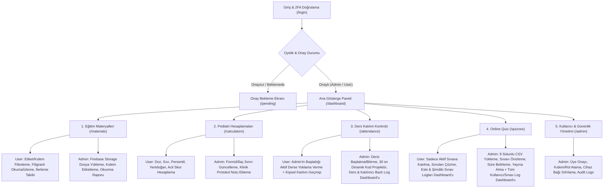

# Pediatrist — Pediatri Eğitim Kliniği Yönetim ve Eğitim Platformu Mimari Planı (`Plan.MD`)

> **Bu belgenin durumu (2026-11-12).** Bölüm 1–4 projenin ilk vizyon ve mimari planıdır ve tarihsel metin olarak
> korunur. Uygulamanın **bugünkü gerçek durumu**, alınan kararlar ve kalan işler
> [`docs/revision/REVISION_PLAN.md`](docs/revision/REVISION_PLAN.md) içindedir; kurulum için [`README.md`](README.md),
> dağıtım için [`DEPLOY.md`](DEPLOY.md). Bölüm 5–8 gerçeğe göre yeniden yazılmıştır. İlk planla uygulama arasındaki
> farklar aşağıdaki tabloda ve ilgili maddelerde "**Güncel:**" notuyla belirtilmiştir.

## 0. İlk plandan farklılaşan kararlar

| Konu | İlk plan | Uygulanan (karar kaydı) |
| :--- | :--- | :--- |
| Yetkinin kaynağı | Firebase Custom Claims | `users/{uid}` dokümanı; claim'ler yalnızca önbellek. Askıya alma ve yetki düşürme anında etkili (D3). |
| Kayıt | İstemci profil yazar | Profili sunucu yazar (`completeRegistration`); davet kodu sunucuda doğrulanır (D4). |
| İki aşamalı doğrulama | TOTP zorunlu | Gerçek TOTP (Identity Platform). Zorunluluğun tek kaynağı `config/security`; doküman yoksa zorunlu (D5, D20, D21). |
| Yoklama cihazı | Cihaz özeti (`boundDeviceHash`) + biyometrik onay | Cihaz bağlama yok (D23, F11.1): yoklama MFA'lı oturum + projektör kodu ile verilir. Önce cihaz özeti (F4.2), sonra passkey (F11.1) kaldırıldı. |
| Sınav soruları | `questions_public` yayındayken hekime açık | İstemciye kapalı; sorular yalnızca girişimle (`startQuizAttempt`) ve cevap anahtarı olmadan gelir. |
| Karne | Teslimde anında doğru cevap + açıklama | Sınav başına gösterim kuralı: varsayılan "sınav kapanınca", isteğe bağlı "teslimde hemen" (D7). |
| Katılmayanlar | Yalnızca katılan ve mazeretli kayıtları | Ders kapanırken "katılmadı" kaydı yazılır; oran = katıldı / (katıldı + katılmadı) (D22). |
| Hesaplayıcılar | Çalışan hesaplama araçları ve doz kilitleri | Formül motoru kapsam dışı; sayfa dürüst "Yakında" durumu ve klinik protokol notu gösterir (D8). |
| Materyal koruması | İndirme/yazdırma engeli | "Filigranlı görüntüleme" (caydırıcı; DRM değil). Sunumlar PDF olarak yüklenir; türler PDF, video, görsel (D11, D19). |
| Hareketsizlik | 15 dk sonra kilit | 14. dakikada uyarı, 15. dakikada gerçek çıkış; sınav ve projektör ekranları muaf. |
| Denetim kayıtları | Giriş/çıkış ve materyal görüntüleme dahil | Yalnızca sunucudaki işlemler (üyelik, yoklama, sınav, materyal yönetimi, KVKK). Giriş/çıkış ve görüntüleme kaydedilmez. Saklama süresi ve TTL var (F9.2). |
| Grafik ve ikon kitaplıkları | Recharts + Lucide | Kullanılmıyor; tek grafik (gelişim eğrisi) elle yazılmış erişilebilir SVG. |
| KVKK | Planda yok | Aydınlatma metni ve sürümlü onay, üye silme (kayıtların addan arındırılması), kişisel veri dökümü (F3.5, F9.1). |

## 1. Proje Vizyonu ve Genel Bakış
**Pediatrist**, bir Pediatri Eğitim Kliniğindeki asistan hekimlerin, uzmanların ve öğretim üyelerinin klinik eğitim süreçlerini tek bir güvenli çatı altında toplamak için tasarlanmış, **%100 Firebase yerel (native) altyapısı** üzerinde çalışan, **sadece onaylı üyelerin erişebildiği (invite-only / admin-approved)** ve **ileri siber güvenlik** standartlarına sahip web tabanlı (PWA uyumlu) bir eğitim ve klinik karar destek platformudur.

### Temel İlkeler
- **%100 Entegre Firebase Mimarisi:** Harici tablo veya üçüncü parti bulut sürücülerine bağımlılık olmadan; kimlik doğrulama, veritabanı, dosya/görsel depolama, sunucu tarafı doğrulama ve barındırma işlemleri tamamen **Firebase (Auth, Firestore, Cloud Storage, Cloud Functions, App Check, Hosting)** üzerinde uçtan uca entegre çalışır.
- **Kapalı Devre Üyelik:** Dışarıdan serbest erişim kapalıdır. Yalnızca klinik yöneticisi (`Admin`) tarafından onaylanan veya kurumsal davet (`invitations`) ile kabul edilen üyeler sisteme girebilir.
- **Rol Tabanlı Erişim Kontrolü (RBAC):** `Admin` (Eğitim Sorumlusu / Öğretim Üyesi / Başasistan) ve `User` (Pediatri Asistanı / Uzman Hekim) rolleri **Firebase Custom Claims**, **Firestore Security Rules** ve **Storage Security Rules** ile hem istemci hem sunucu katmanında zorunlu tutulur.
- **Ayrı Sayfa ve Modüler Yönetim:** Her ana fonksiyon kendi bağımsız sayfasında (`/materials`, `/calculators`, `/attendance`, `/quizzes`) görüntülenir ve yetkiye göre aynı modül içinden yönetilir.
- **İleri Seviye Siber Güvenlik (Zero-Trust):** Çok faktörlü kimlik doğrulama (MFA/TOTP), Firebase App Check, 30 saniyede bir kriptografik değişen dinamik yoklama kodu (elle girilir), filigranlı materyal görüntüleme, sunucu tarafı sınav değerlendirmesi ve değiştirilemez denetim kayıtları (`audit_logs`).

---

## 2. Teknoloji Yığını (Tech Stack)

| Katman | Teknoloji | Görevi ve Entegrasyon Rolü |
| :--- | :--- | :--- |
| **Frontend Çatısı** | **Next.js 15 (App Router) + TypeScript** | Güçlü tip güvenliği, modüler sayfa yapısı, rota koruma kalkanları ve mobil PWA desteği. |
| **Stil & Tasarım Sistemi** | **Vanilla CSS (`src/styles/index.css`) + CSS Custom Properties** | Maksimum esneklik ve kontrol sağlayan HSL tabanlı klinik tasarım tokenları, akıcı (fluid) responsive düzen ve sıfır harici CSS çatısı bağımlılığı. |
| **Veri Görselleştirme** | Elle yazılmış SVG (**Güncel:** Recharts ve Lucide kullanılmıyor) | Hekim kişisel gelişim eğrisi; tablolar erişilebilir `DataTable` bileşeniyle. |
| **Kimlik Doğrulama** | **Firebase Authentication (Identity Platform)** | E-posta/Şifre + Zorunlu **MFA (TOTP)**, Custom Claims (`role: 'admin' \| 'user'`, `status: 'active' \| 'pending' \| 'suspended'`), anlık oturum iptali. |
| **Veritabanı** | **Cloud Firestore** | Gerçek zamanlı dinleyiciler (`onSnapshot`) ile canlı yoklama, aktif sınav seansları, soru arşivi ve kişisel gelişim takibi. |
| **Dosya & Görsel Depolama** | **Firebase Cloud Storage** | Eğitim materyallerinin (PDF, video, sunum) ve sınavlardaki klinik/radyoloji vaka görsellerinin yetki korumalı depolanması (`storage.rules`). |
| **Sunucu Mantığı** | **Firebase Cloud Functions (2nd Gen, TypeScript)** | Kriptografik yoklama doğrulaması, sınav cevaplarının sunucu tarafında değerlendirilmesi, otomatik soru arşivleme ve `audit_logs` yazımı. |
| **Bot & API Koruması** | **Firebase App Check (reCAPTCHA Enterprise)** | Yetkisiz istemcilerin veya botların Firebase API'lerine doğrudan istek atmasını engeller. |
| **Barındırma** | **Firebase App Hosting / Hosting** | Otomatik SSL/TLS, global CDN ve sıkı HTTP güvenlik başlıkları (`CSP`, `HSTS`, `X-Frame-Options`). |

### 2.1. Klinik UI/UX Tasarım Sistemi ve Web Geliştirme Standartları
- **İşlev Odaklı Klinik Tasarım (Function-Driven Design):** Pediatri acil, yoğun bakım ve poliklinik temposunda hekimlerin en az tıklama ve sıfır bilişsel yükle hedefe ulaşmasını sağlayan sade, sezgisel ve hızlı bilgi hiyerarşisi.
- **HSL Renk Paleti ve Tipografi (`src/styles/index.css`):**
  - Göz yormayan klinik arduvaz/beyaz yüzey tonları, güven veren tıbbi kobalt/turkuaz vurgu renkleri ve doz aşımı/kritik sınır uyarıları için yüksek kontrastlı semantik HSL renk tokenları (`--color-clinical-primary`, `--color-alert-critical`, `--surface-elevated`).
  - Okunabilirliği maksimuma çıkaran Google Fonts kombinasyonu: Klinik vaka metinleri ve arayüz için **`Plus Jakarta Sans`**, ilaç dozları, hesaplama çıktıları, geri sayım sayaçları ve 6 haneli yoklama kodları için **`JetBrains Mono` (`font-variant-numeric: tabular-nums`)**.
  - **Görsel Disiplin (Anti-Cliché Kuralları):** Koyu zeminde mor/neon parlamalar, gradyan metin dolguları, aşırı iç içe geçmiş (over-nested) kartlar veya dekoratif karmaşa kesinlikle kullanılmaz; her piksel klinik bir işleve hizmet eder.
- **Semantik HTML5, Erişilebilirlik ve Benzersiz Kimlikler (`Unique IDs`):**
  - Her bağımsız sayfa (`/materials`, `/calculators`, `/attendance`, `/quizzes`, `/admin`) kendine özgü `<title>`, `<meta name="description">`, tek bir `<h1>` başlık hiyerarşisi ve semantik HTML5 etiketleri (`<main>`, `<section>`, `<article>`, `<nav>`, `<aside>`) içerir.
  - Tüm etkileşimli form elemanları ve butonlar deterministik test ve erişilebilirlik için benzersiz, açıklayıcı `id` niteliklerine sahiptir (Örn: `id="calc-weight-kg-input"`, `id="quiz-submit-attempt-btn"`).

---

## 3. İleri Seviye Siber Güvenlik Mimarisi (Advanced Cybersecurity)

Klinik eğitim verileri, hekim bilgileri ve yoklama/sınav bütünlüğü için **7 katmanlı Zero-Trust güvenlik modeli** uygulanacaktır:

### 3.1. Kimlik ve Erişim Güvenliği
1. **Kapalı Kayıt & Admin Onayı (Allowlist / Approval Flow):**
   - Kullanıcı kayıt olduğunda varsayılan durumu `status: "pending"` olur ve hiçbir klinik sayfaya erişemez (`/pending` ekranında bekler).
   - Yalnızca `Admin` tarafından onaylanan veya önceden e-postası davet listesine (`invitations` koleksiyonu) eklenen kullanıcılar etkinleşir.
   - **Güncel:** Yetkinin kaynağı `users/{uid}` dokümanıdır; claim'ler önbellektir (D3).
2. **Zorunlu Çok Faktörlü Doğrulama (MFA):**
   - Firebase Auth üzerinden TOTP (Google / Microsoft Authenticator) tabanlı 2 aşamalı doğrulama zorunlu tutulur.
3. **Otomatik Oturum Zaman Aşımı (Idle Timeout) & Token İptali:**
   - Klinik bilgisayarlarda açık unutulan oturumlar 15 dakika hareketsizlik sonrasında kapatılır (**Güncel:** kilit değil gerçek çıkış; 14. dakikada uyarı; sınav ve projektör ekranları muaf).
   - Rol değişimi veya şüpheli işlemde Cloud Function üzerinden `admin.auth().revokeRefreshTokens(uid)` çağrılarak aktif oturumlar anında sonlandırılır.

### 3.2. Uygulama ve API Güvenliği
1. **Firebase App Check:**
   - Firestore, Cloud Storage ve Callable Cloud Functions üzerinde App Check zorunlu tutulur. Uygulama arayüzü dışından (cURL, Postman, script) gelen tüm istekler reddedilir.
   - **Güncel:** Functions tarafında zorunluluk `ENFORCE_APP_CHECK` parametresiyle `guards.ts` içinde uygulanır (emülatörde kapalı); Firestore ve Storage için konsoldan açılır (`DEPLOY.md`).
2. **Sunucu Tarafı Doğrulama (Zero Client Trust):**
   - Sınavların doğru cevapları (`correctAnswers`), pedagojik açıklamaları (`feedbackText`) ve yoklama oturumlarının gizli HMAC anahtarları **asla** sınav/yoklama esnasında istemciye gönderilmez. Puanlama ve doğrulama yalnızca **Cloud Functions** üzerinde çalışır.
3. **Sıkı Güvenlik Başlıkları (HTTP Security Headers):**
   - `Content-Security-Policy (CSP)`, `Strict-Transport-Security (HSTS)`, `X-Content-Type-Options: nosniff`, `X-Frame-Options: DENY`, `Referrer-Policy: strict-origin-when-cross-origin`, `Permissions-Policy`.

#### 3.3. Veri, Dosya ve Denetim Güvenliği
1. **Eğitim Materyali ve Vaka Görseli Sızıntı Önleme:**
   - Firebase Cloud Storage içindeki eğitim dosyaları ve klinik sınav görselleri herkese açık (`public`) değildir; yalnızca `request.auth.token.status == 'active'` olan üyeler okuyabilir.
   - Eğitim materyalleri uygulama içinde aktif hekimin **Adı Soyadı + E-postası + Tarih/Saat** bilgisini içeren **dinamik filigran (watermark)** ile görüntülenir (ham cihaz kimliği filigrana veya ekrana yansıtılmaz).
   - **Güncel:** Filigran caydırıcıdır, teknik bir kopya koruması (DRM) değildir (D11).
2. **Değiştirilemez Denetim Kayıtları (`audit_logs`):**
   - Yoklama doğrulamaları, sınav işlemleri, materyal yönetimi, yetki değişiklikleri ve KVKK işlemleri yalnızca Cloud Functions tarafından yazılabilen (istemci tarafından silinemeyen ve değiştirilemeyen) `audit_logs` koleksiyonunda tutulur.
   - **Güncel:** Giriş/çıkış ve materyal görüntüleme kaydedilmez. Kayıtlar saklama süresi sonunda otomatik silinir (varsayılan 2 yıl; `DEPLOY.md`).

### 3.4. Kimlik Bilgisi ve Altyapı Sızıntısı Önleme (Zero Credential & Identifier Exposure)
1. **Arayüzde Sıfır Altyapı Bilgisi:**
   - Hiçbir kullanıcı (`User`) veya yönetici (`Admin`) ekranında Firebase `projectId`, `apiKey`, `authDomain`, `storageBucket`, `messagingSenderId`, `appId`, ham cihaz kimliği (`boundDeviceId`) veya beklenen 30 saniyelik HMAC doğrulama kodu paylaşılmaz.
   - `src/lib/firebase/client.ts` yapılandırma nesnesini dışa aktarmaz; yalnızca `isFirebaseConfigured()` ile boolean bağlantı durumu döndürür.
2. **Ortam Değişkeni İzolasyonu ve Cihaz Özeti (Hashing):**
   - Tüm Firebase anahtarları kaynak kodda sabit (`hardcoded`) tutulmaz; yalnızca git'e girmeyen `.env.local` ve sunucu ortam değişkenlerinden okunur.
   - **Güncel:** Next tarafında Admin SDK kullanılmaz (`src/lib/firebase/admin.ts` silindi). Yoklamada cihaz bağlama yoktur (D23); kimlik MFA'lı oturumdan gelir.
3. **Kesin Rol Ayrımı (Uygulama İçi Rol Değiştirme Yok):**
   - Arayüzde istemci taraflı `viewMode` veya "Rol Değiştir" anahtarı bulunmaz; kullanıcı rolü `ClinicSessionContext` içinde canlı dinlenen `users/{uid}` dokümanından okunur (**Güncel:** token değil doküman, D3).

---

## 4. Sayfa Yapısı ve Modül Tasarımları

Her bir ana fonksiyon **ayrı bir sayfada** gösterilir ve kullanıcının doğrulanmış rolüne (`Admin` veya `User`) göre kesin olarak ayrılmış yetkilerle çalışır.



---

### Modül 1: Eğitim Materyalleri Paylaşma ve Görüntüleme (`/materials`)
Klinik içi ders sunumları, güncel pediatri kılavuzları (AAP, ESPGHAN, Türk Pediatri Kurumu vb.), makaleler ve eğitim videolarının yönetildiği sayfadır.

- **Hekim (`User`) Görünümü:**
  - **Etiket & Kıdem Filtreleme:** Admin'in serbestçe oluşturduğu etiketlere (D25; ör. Yenidoğan, Çocuk Acil) ve hedef kıdeme (1.–4. Yıl, Uzman; D26) göre filtreleme. Admin listesinde ayrıca arama | etiket | hedef kıdem süzgeci (F11.7).
  - **Güvenli Uygulama İçi Görüntüleyici:** PDF ve sunumlar Firebase Cloud Storage üzerinden güvenli akışla çekilir; üzerinde aktif kullanıcının adı-soyadı, e-postası ve zaman damgası bulunan dinamik filigran (watermark) ile görüntülenir (`allowDownload: false` olan materyaller için indirme/yazdırma engellenir).
  - **Okundu / Tamamlandı Takibi:** Hekimin hangi materyali ne kadar süre incelediği kaydedilir; zorunlu materyaller için kişisel ilerleme yüzdesi gösterilir.
- **Yönetici (`Admin`) Yönetim Fonksiyonları:**
  - Doğrudan Firebase Cloud Storage'a materyal yükleme (PDF, Video, Sunum).
  - Materyal meta verilerini düzenleme (Başlık, Bilim Dalı, Hedef Kıdem, Zorunlu Okuma mı?, İndirilebilir mi?).
  - Materyali hangi hekimlerin okuyup tamamladığını gösteren **Klinik Okunma Raporu**.

---

### Modül 2: Pediatri Hesaplama Uygulamaları (`/calculators`)
Klinik pratikte ve eğitimde en sık kullanılan, hata payını sıfıra indirmeyi amaçlayan doğrulanmış pediatrik tıbbi hesaplayıcılar sayfasıdır.

- **Hesaplama Araçları (Alt Sekmeler / Kartlar):**
  1. **Antropometri & Büyüme:** Yaş/Cinsiyete göre Persentil ve Z-Skoru (Boy, Kilo, Baş Çevresi, VKİ — WHO & Neyzi referansları), Vücut Yüzey Alanı (**BSA** — Mosteller & Haycock formülleri).
  2. **Pediatrik Sıvı & Elektrolit Yönetimi:** **Holliday-Segar** idame sıvı hesaplama, dehidratasyon derecesine göre defisit + idame sıvı planı, hipernatremi/hiponatremi düzeltme hızı.
  3. **Pediatrik İlaç & Acil Resüsitasyon Dozları (PALS / NRP):** Kilo bazlı adrenalin, adenozin, amiodaron, antiepileptikler, antibiyotik dozları ve **Broselow** renk/kilo bandı (entübasyon tüp çapı, derinliği, defibrilasyon joule hesabı).
  4. **Yenidoğan (Neonatoloji) Hesaplayıcıları:** Saatlik postnatal yaşa ve gebelik haftasına göre **Fototerapi & Kan Değişimi (Bilirubin)** eşikleri, düzeltilmiş yaş hesabı, Apgar skoru.
  5. **Klinik Skorlamalar ve Böbrek Fonksiyonu:** Pediatrik Glasgow Koma Skalası (pGCS), **Bedside Schwartz** formülü ile eGFR, PEWS (Pediatrik Erken Uyarı Skoru), Westley Krup Skoru, PRAM Astım Skoru.
> **Güncel (D8):** Bu modülde hesaplama **yapılmaz**. Sayfa planlanan beş hesaplayıcıyı "Yakında" olarak listeler
> ve eğitim sorumlusunun yazdığı klinik protokol notunu gösterir. Aşağıdaki maddeler ileride yapılacak formül
> motorunun hedefidir; doz sınırları ve güvenlik uyarıları henüz yoktur.

- **Hekim (`User`) Görünümü:**
  - Hızlı arama, yaş/kilo girildiğinde acil parametrelerin anlık hesaplanması ve "Aşırı Doz / Fizyolojik Sınır Dışı Değer" güvenlik uyarıları (Guardrails).
  - Hasta mahremiyeti (KVKK) gereği girilen hasta ölçümleri veritabanına **kaydedilmez**, yalnızca anlık tarayıcı belleğinde hesaplanır.
- **Yönetici (`Admin`) Yönetim Fonksiyonları:**
  - Hesaplayıcıların altına Firestore tabanlı **"Klinik Protokol Notu"** ekleme/güncelleme.
  - İlaç doz aralıklarını ve maksimum doz sınırlarını (`maxDose`) yönetme.

---

### Modül 3: Derslere Katılım Kontrolü — Personal Real-Time Authentication (`/attendance`)
Klinik sabah toplantıları, makale saatleri, mortalite toplantıları ve teorik derslerde **başkasının yerine imza atmayı veya ekran görüntüsüyle uzaktan yoklama vermeyi imkansız kılan** gerçek zamanlı kişisel doğrulama sayfasıdır.

- **Kriptografik & Cihaz Bağlamlı Yoklama Protokolü:**
  1. **Yoklama Alınacak Dersi Admin Başlatır (`startLectureSession`):** Yoklama yalnızca `Admin` tarafından ders başlığı, eğitici ve yoklama açık kalma süresi (dakika) belirlenerek (kategori yok, F11.3) başlatıldığında açılır. Aktif ders yokken hekim ekranında yoklama girişi kapalıdır.
  2. **Canlı Projektör Ekranı (`getProjectorCode`):** Canlı ders süresince projektöre **her 30 saniyede bir kriptografik olarak yenilenen (HMAC-SHA256) 6 haneli doğrulama kodu** yansıtılır (D28; QR yok).
  3. **Kişisel Doğrulama (`User` — `verifyRealTimeAttendance`):**
     - **Adım A (Yetki):** Yalnızca rolü hekim olan 1.–4. yıl asistan yoklama verir (D24); kimlik MFA'lı oturumdan gelir, cihaz bağlama yoktur (D23).
     - **Adım B (30 Saniyelik Kod Doğrulaması):** Projektördeki kod telefondan elle girilir (QR yok, D28); sunucu kodun son 30 saniyelik pencereye (veya bir öncekine) ait olduğunu doğrulayarak kaydı `attendance_sessions/{sessionId}/records/{uid}` ve `attendance_logs` koleksiyonlarına yazar.
- **Hekim (`User`) Görünümü:**
  - Yalnızca Admin tarafından başlatılmış canlı ders varsa yoklama doğrulama formu.
  - Hekimin **yalnızca kendi geçmiş ders katılımlarını** gördüğü Kişisel Ders Katılım Geçmişi tablosu.
- **Yönetici (`Admin`) Katılım Yönetimi ve Log Dashboard'u:**
  1. **Ders Başlatma & Canlı Projektör:** Yeni ders yoklaması başlatma, süreyi belirleme, canlı projektör kodunu yansıtma, mazeretli (`excused`) işaretleme ve yoklamayı kapatma (`endLectureSession`).
  2. **Ders Bazlı Katılım Log Dashboard'u:** Tüm derslerin listesi, her dersin katılım yüzdesi, seçilen dersteki tüm hekimlerin katılım/mazeret/doğrulama saati/yöntem logları ve tek tıkla CSV dışa aktarım.
  3. **Katılımcı (Hekim) Bazlı Katılım Log Dashboard'u:** Her bir hekimin katıldığı/mazeretli olduğu/katılmadığı ders sayısı, genel katılım yüzdesi (`<%70` uyarı rozeti), hekime tıklandığında açılan tüm ders geçmişi logları ve CSV dışa aktarım.

---

### Modül 4: Online Quiz ve Klinik Vaka Değerlendirme Yapısı (`/quizzes`)

Tamamen **Firebase Firestore, Firebase Cloud Storage ve Cloud Functions** üzerinde çalışan; `User` ve `Admin` yetkilerinin kesin olarak ayrıldığı sınav modülüdür.

#### 4.1. Standart 9 Alanlı Klinik Soru Veri Modeli ve CSV Yapısı
Her bir sınav sorusu, mevcut 9 sütunlu CSV yapısına birebir uyumlu olan **9 standart alandan** oluşur:

| Sıra | CSV Sütun Başlığı | Sistem Alanı (Firestore) | Açıklama ve Sistem Davranışı |
| :---: | :--- | :--- | :--- |
| **1** | **Soru İçeriği** | `caseContent` | Klinik vaka sunumu, hasta öyküsü, fizik muayene ve laboratuvar bulguları. |
| **2** | **Soru Görseli** | `imageUrl` | Opsiyonel klinik, radyoloji, EKG veya laboratuvar görseli (`https://` veya `quiz_media/`). |
| **3** | **Sorunun Kendi** | `questionText` | Vakanın altında yer alan doğrudan soru cümlesi. |
| **4** | **Soru Tipi** | `questionType` | `Single Choice` (Tek Seçmeli), `Multiple Choice` (Çoklu Seçmeli) veya `Text Input` (Açık Uçlu Metin). |
| **5** | **Maximum Length** | `maxLength` | `Text Input` soruları için geçerli maksimum karakter sınırı (`1..2000`). |
| **6** | **Seçenekler** | `optionsRaw` | Şıkların `\|` ile ayrıldığı metin (Örn: `Sepsis \| Meningokoksemi \| Kawasaki \| Kızıl`). |
| **7** | **Seçenekler (JSON)** | `optionsArray` | JSON dizi formatındaki seçenekler (`["Sepsis", "Meningokoksemi", ...]`) veya 6. sütundan otomatik dönüştürülen dizi. |
| **8** | **Doğru Seçenek (JSON)** | `correctAnswers` | Tekli seçim (`["Kawasaki"]`), çoklu seçim veya açık uçlu kabul edilen doğru yanıt varyasyonları. |
| **9** | **Feedback_Text** | `feedbackText` | Sorunun doğru veya yanlış yanıtlanmasından bağımsız olarak sınav sonunda hekime açılan **Öğrenme Noktası**. |

> [!IMPORTANT]
> **Sınav Güvenliği (Cevap ve Feedback İzolasyonu):** Sınav devam ederken istemciye (hekimin tarayıcısına) yalnızca **1–7. alanlar** gönderilir. **8. alan (`correctAnswers`)** ve **9. alan (`feedbackText`)** istemciye tamamen kapalı olan `quiz_answer_keys` koleksiyonunda tutulur.
>
> **Güncel:** `questions_public` de istemciye kapalıdır; sorular yalnızca girişim başlatıldığında (`startQuizAttempt`) gelir, böylece süre başlamadan soru okunamaz. Doğru cevap ve açıklama sınavın gösterim kuralına göre açılır: varsayılan "sınav kapanınca" (erken bitiren hekim cevabı meslektaşına aktaramaz), isteğe bağlı "teslimde hemen" (D7).

#### 4.2. Hekim (`User`) Deneyimi (`/quizzes` — Sadece Sınava Katılma ve Kişisel Log Dashboard'u)
`User` rolündeki hekim ekranında **hiçbir Admin yetkisi, soru düzenleme formu veya diğer kullanıcıların verisi yer almaz**:
1. **Aktif Sınava Katılma ve Sınav Sorularını Çözme (`ClinicalExamRunner`):**
   - Hekim yalnızca Admin'in yayına aldığı aktif sınavı (ve Admin'in belirlediği sınav süresini) görerek sınava katılır (`startQuizAttempt`).
   - Sınav süresince geri sayım sayacı ve sekme değiştirme (`VisibilityChange`) takibi çalışır; süre bittiğinde veya hekim teslim ettiğinde yanıtlar sunucuda değerlendirilir (`submitQuizAttempt`).
2. **Anında Geri Bildirim Karnesi (`InstantFeedbackReport`):**
   - Sınav tamamlandığında puan ve her sorunun doğru/yanlış sonucu gösterilir; doğru yanıt ve **Öğrenme Noktası (`Feedback_Text`)** sınavın gösterim kuralına göre açılır (**Güncel:** D7).
3. **Eski ve Şimdiki Sınav Logları Dashboard'u (`DoctorGrowthDashboard`):**
   - Hekim katıldığı **eski sınavların ve şimdiki sınavının loglarını** (tarih, sınav adı, doğru/toplam, puan, başarı gelişim eğrisi) kendi kişisel dashboard'unda takip eder ve istediği sınavın detaylı karnesini tekrar açıp inceleyebilir.

#### 4.3. Yönetici (`Admin`) Deneyimi (`/quizzes` — CSV Yükleme, Önizleme, Süre Belirleme ve Merkezi Log Dashboard'u)
1. **CSV Dosyası Yükleme (`parseNineFieldQuizCsv`):**
   - Admin yeni sınav başlatmak istediğinde mevcut 9 sütunlu sınav yapısına uygun bir `.csv` dosyası yükler (veya örnek 9 sütunlu CSV şablonunu indirir).
   - Sistem her satırı 9 alan kuralına göre doğrular; hatalı satır varsa satır ve sütun numarasıyla Admin'e bildirir ve hatalar giderilene kadar yayına almayı kilitler.
2. **Sınavı Önizleme, Sınav Süresini Belirleme ve Yayına Alma (`AdminQuizStudio`):**
   - Admin yüklenen CSV'deki soruları hekimlerin göreceği biçimde (veya cevap anahtarı + `Feedback_Text` açık olarak) **önizler**.
   - Admin **sınav süresini (dakika, 1–180 dk)** ve sınav başlığını kendisi belirler, ardından **Sınavı Yayına Alır (`saveQuizDraft` + `publishQuiz`)**.
   - Yeni sınav yayına alındığında bir önceki aktif sınav otomatik olarak kapatılır ve soruları 9 alanlı yapısıyla **`quiz_question_archive` (Kayıp Önleyici Soru Arşivi)** koleksiyonuna taşınır.
3. **Tüm Kullanıcı ve Sınavların Loglarını İzleme Dashboard'u (`AdminCentralAnalytics`):**
   - Admin; **Tüm Girişim Logları** (hekim, kıdem, sınav, tarih, doğru/toplam, puan, sekme değiştirme sayısı ve karne detayı), **Kullanıcı (Hekim) Bazlı Özet** ve **Sınav Bazlı Özet** sekmeleriyle tüm hekimlerin ve tüm sınavların loglarını tek bir merkezi dashboard üzerinden takip eder, filtreler ve CSV/Excel olarak indirir.

---

### Modül 5: Kullanıcı, Rol ve Güvenlik Yönetimi (`/admin`)
Yalnızca `Admin` rolüne sahip kullanıcıların erişebildiği yönetim sayfasıdır:
- Bekleyen üyelik başvurularını (`pending`) onaylama / askıya alma (`suspended`).
- Kullanıcı rolü (`Admin` / `User`) ve asistan kıdem yılı (`1..4`) atama.
- Kullanıcının iki aşamalı doğrulamasını sıfırlama.
- **Güncel:** davet oluşturma/iptal, üye silme (kayıtların addan arındırılması) ve kişisel veri dökümü de bu sayfadadır.
- Değiştirilemez `audit_logs` (Siber Güvenlik Denetim Kayıtları) izleme ekranı (hiçbir proje kimliği veya API anahtarı ekrana yansıtılmaz).

---

## 5. Firebase Veritabanı Şeması (Cloud Firestore)

Güncel şema. Tek kaynak `functions/src/shared/types.ts` içindeki doküman tipleridir; bu özet oradan türetilmiştir.
İstemci yalnızca `materials/{id}/progress/{uid}` dokümanına yazabilir; diğer bütün yazımlar Cloud Functions'tadır.

```text
firestore-root/
├── users/{uid}                          <-- yetkinin TEK kaynağı; yalnızca sunucu yazar
│   ├── uid, email, fullName, title, residencyYear (1..4 | null), role, status
│   ├── consent { version, acceptedAt }  (KVKK aydınlatma metni onayı)
│   ├── tokensValidAfter (epoch sn; bundan önce açılan oturumlar geçersiz)
│   └── createdAt, updatedAt, approvedBy, updatedBy, inviteCode
│
├── config/security                      <-- MFA / e-posta doğrulama zorunluluğu; doküman yoksa ikisi de zorunlu
│   └── requireMfa, requireEmailVerified
│
├── invitations/{inviteId}
│   └── code, email, intendedRole, residencyYear, invitedBy, createdAt, expiresAt, used, usedBy, usedAt, revoked…
│
├── materials/{materialId}
│   ├── title, description, labels[], targetYears[], targetSpecialists, isMandatory, allowDownload
│   ├── fileType ("pdf" | "video" | "image"), storagePath, contentType, sizeBytes
│   ├── status ("draft" | "published"), uploadedBy, uploadedByName, createdAt, publishedAt, updatedAt
│   └── progress/{uid} -> { uid, secondsSpent, lastPage, completed, updatedAt }   (hekim kendi kaydını yazar)
│
├── calculators_config/{calculatorId}    <-- klinik protokol notu (hesaplama yok)
│   └── calculatorId, protocolNote, updatedBy, updatedByName, updatedAt
│
├── attendance_sessions/{sessionId}
│   ├── title, lecturer, durationMinutes, status ("live" | "closed"), startedAt, endsAt, startedBy
│   ├── presentCount, excusedCount, absentCount, expectedAttendees[], expectedCount
│   ├── closedAt, closedBy, closeReason ("manual" | "expired")
│   └── records/{uid} -> { uid, fullName, title, residencyYear, status ("present" | "excused" | "absent"),
│                          method ("code" | "admin_excused" | "system_absent"; eski kayıtlarda "qr+webauthn"), verifiedAt, excuseNote, markedBy }
│
├── attendance_logs/{sessionId}_{uid}    <-- raporlar için düz kopya (kayıt alanları + ders bilgisi)
├── attendance_secrets/{sessionId}       <-- istemciye kapalı: hmacSecret, projectorIpHash
├── attendance_meta/live                 <-- istemciye kapalı: tek canlı ders kilidi
│
├── quizzes/{quizId}
│   ├── title, status ("draft" | "published" | "closed"), durationMinutes, closesAt
│   ├── revealPolicy ("after_close" | "immediate"), revealAt, questionCount, attemptCount, sourceFileName
│   ├── createdAt, createdBy, publishedAt, publishedBy, closedAt, closedBy, closeReason
│   └── questions_public/{questionId}    <-- 1–7. alanlar; istemciye KAPALI (yalnızca admin okur; hekime girişimle gelir)
│
├── quiz_answer_keys/{quizId}/items/{questionId}   <-- 8–9. alanlar: correctAnswers, feedbackText (hekime kapalı)
├── quiz_question_archive/{archiveId}    <-- kapanan sınavların 9 alanı + sourceQuizId, sourceQuizTitle, archivedAt
│
├── quiz_attempts/{quizId}_{uid}
│   ├── quizId, quizTitle, uid, doctorName, residencyYear, status ("in_progress" | "submitted"), revealPolicy
│   ├── startedAt, deadline, durationMinutes, submittedAt, durationSeconds, lateSubmission, autoSubmitted
│   ├── score (0..100), correctCount, totalQuestions, tabSwitchCount
│   └── results[] -> { questionId, orderIndex, isCorrect, userResponse }   (doğru cevap ve açıklama SAKLANMAZ)
│
├── quiz_attempt_drafts/{quizId}_{uid}   <-- istemciye kapalı: süre içinde kaydedilen yanıtlar
├── rate_limits/{tür}_{uid}              <-- istemciye kapalı: hız sınırı sayaçları (TTL)
│
└── audit_logs/{logId}                   <-- yalnızca sunucu yazar, admin okur, kimse değiştiremez
    └── actorUid, actorEmail, action, resourceType, resourceId, severity, timestamp, metadata,
        ipHash (tuzlu ağ özeti), userAgent, expireAt (saklama süresi sonu; TTL)
```

Cloud Storage: `materials/{materialId}/{dosya}` (PDF, video, görsel) ve `quiz_media/{dosya}` (sınav görselleri).

---

## 6. Firestore & Storage Güvenlik Kuralları Özeti

Güncel özet (`firestore.rules`, `storage.rules`; 58 kural testi `tests/rules/` altında):

- **Ortak şartlar:** "etkin üye" = `users/{uid}.status == 'active'`, oturum iptal zamanından sonra açılmış ve
  (zorunluysa) e-postası doğrulanmış ve ikinci faktörle girilmiş. Bu şartlar token'daki claim'lerden değil
  dokümandan okunur.
- **`users`:** üye kendi profilini, admin hepsini okur. İstemci yazamaz.
- **`materials`:** hekim yalnızca yayındaki materyali okur; kendi `progress` kaydını (yalnızca izinli alanlarla ve
  yalnızca yayındaki materyale) yazar. Diğer yazımlar callable'larla.
- **`attendance_sessions`:** hekim yalnızca canlı dersi ve kendi kaydını okur; `attendance_logs`'ta yalnızca kendi
  satırlarını. Geçmiş dersler ve bütün kayıtlar admin'e açıktır.
- **`quizzes`:** hekim yayındaki ve kapanmış sınavın başlığını okur; `questions_public`, `quiz_answer_keys` ve
  `quiz_question_archive` hekime kapalıdır. `quiz_attempts`'ta herkes yalnızca kendi girişimini okur.
- **`invitations`, `audit_logs`:** yalnızca admin okur; istemci yazamaz.
- **Tamamen kapalı (admin dahil):** `attendance_secrets`, `attendance_meta`, `webauthn_challenges` (eski veri),
  `quiz_attempt_drafts`, `rate_limits`.
- **Storage:** dosyaları etkin üyeler okur; yalnızca admin yükler ve siler; tür ve boyut sınırları kuralda ve
  `functions/src/shared/constants.ts` içinde aynıdır (birim testi eşitliği denetler).

---

## 7. Proje Dizin Yapısı

```text
pediatrist/
├── src/                                 # Next.js istemcisi
│   ├── app/
│   │   ├── (auth)/                      # login, register, reset, pending
│   │   ├── (public)/kvkk/               # KVKK aydınlatma metni
│   │   ├── (protected)/                 # layout (oturum + gezinme), dashboard, materials, calculators,
│   │   │                                #   attendance (+ projector), quizzes, admin, account/security, account/device
│   │   └── layout.tsx                   # yapılandırma denetimi, yazı tipleri
│   ├── components/
│   │   ├── ui/                          # ortak primitifler: Button, Card, Dialog, ConfirmDialog, DataTable, Field, Tabs, Toast…
│   │   ├── admin/                       # üyeler, davetler, denetim kayıtları
│   │   ├── attendance/                  # yoklama (hekim), ders yönetimi, projektör, raporlar
│   │   ├── quizzes/                     # sınav stüdyosu, sınav ekranı, karne, analitik, gelişim grafiği
│   │   ├── materials/                   # yükleme/yönetim, görüntüleyici (pdf.js + filigran)
│   │   ├── dashboard/, calculators/, auth/, nav/, security/, system/
│   ├── hooks/                           # useAsyncAction, useFirestoreSnapshot (+ useCapped)
│   ├── lib/
│   │   ├── auth/                        # oturum bağlamı, oturum kararı, hareketsizlik, MFA
│   │   ├── firebase/                    # client.ts, config.ts, callables.ts
│   │   ├── admin/, attendance/, quiz/, materials/, dashboard/, pediatrics/   # modül veri katmanları (okuma kancaları, saf hesaplar)
│   │   └── errors.ts, csv.ts, privacy.ts, kvkk.ts
│   └── styles/                          # tokens.css, index.css, ui.css
├── functions/src/                       # Cloud Functions v2 (europe-west1)
│   ├── shared/                          # ORTAK sözleşmeler: schemas.ts (zod), constants.ts, types.ts, consent.ts, security.ts, quizCsv.ts
│   ├── callable.ts, guards.ts, validate.ts          # callable tanımı, yetki (tek yer), istek doğrulama
│   ├── members.ts, privacyService.ts                # üyelik, davet, KVKK (onay, silme, döküm)
│   ├── attendanceService.ts                         # yoklama
│   ├── quizService.ts, quizGrading.ts               # sınav, puanlama
│   ├── materialsService.ts, calculatorsService.ts
│   ├── scheduled.ts                                 # süresi dolan ders ve sınavları kapatma
│   └── auditLogger.ts, requestContext.ts, rateLimit.ts, config.ts
├── config/securityHeaders.ts            # CSP ve güvenlik başlıkları (tek kaynak)
├── scripts/                             # seed-emulator.ts (yalnızca emülatör), check-no-mock.mjs, firebase.mjs
├── e2e/                                 # Playwright (masaüstü + telefon), erişilebilirlik, CSP bekçisi
├── tests/unit/, tests/rules/            # Vitest: birim ve güvenlik kuralı testleri
├── functions/test/                      # Vitest: callable testleri (emülatör)
├── firestore.rules, firestore.indexes.json, storage.rules, firebase.json
├── docs/revision/                       # AUDIT.md (bulgular), REVISION_PLAN.md (plan, kararlar, ilerleme)
└── README.md, DEPLOY.md, CLAUDE.md, Plan.MD
```

---

## 8. Uygulama Durumu

> Bu bölümün ilk sürümü Faz 1–6'yı "Tamamlandı" olarak işaretliyordu. 2026-11'deki denetim
> ([`docs/revision/AUDIT.md`](docs/revision/AUDIT.md)) o sürümün sunucuya bağlı olmayan bir prototip olduğunu
> gösterdi: ekranlar sabit örnek veriyle çalışıyor, sunucu hataları yutulup "başarılı" gösteriliyor, iki aşamalı
> doğrulama herhangi altı rakamı kabul ediyordu. Aşağıdaki durum, ardından yapılan revizyon programına göredir;
> ayrıntı ve kanıt [`docs/revision/REVISION_PLAN.md`](docs/revision/REVISION_PLAN.md) §1 (ilerleme tablosu) içindedir.

| Alan | Durum |
| :--- | :--- |
| Altyapı: test, CI, emülatör, sahte veri bekçisi | Tamamlandı (F0) |
| Ortak sözleşmeler, yetki katmanı, hata gösterimi | Tamamlandı (F1) |
| Güvenlik kuralları, kayıt, oturum, CSP | Tamamlandı (F2) |
| Tasarım sistemi, gezinme, giriş/kayıt ekranları, gerçek TOTP | Tamamlandı (F3). TOTP emülatörde sınanamıyor; staging'de sınanacak. |
| Ders yoklaması (elle kod, projektör, raporlar) | Tamamlandı (F4, F11, F12) |
| Sınavlar (stüdyo, sınav ekranı, karne, analitik) | Tamamlandı (F5) |
| Materyaller (yükleme, görüntüleyici, okunma raporu) | Tamamlandı (F6) |
| Yönetim paneli, ana sayfa, hesaplayıcı sayfası | Tamamlandı (F7). Hesaplayıcılarda **hesaplama yok** (bilinçli karar, D8). |
| Erişilebilirlik, metin, performans | Tamamlandı (F8) |
| KVKK, operasyon, dokümantasyon | Tamamlandı (F9). Aydınlatma metni **hukuk onayı bekliyor** (taslak işaretli). |
| Teslim belgeleri: staging kontrol listesi, kabul testi senaryoları, izlenebilirlik | Tamamlandı (F10). **Staging kurulumunun ve kabul testinin kendisi yapılmadı**; kullanıcı tarafında. |

**Henüz yapılmayanlar / doğrulanmayanlar:**

- Gerçek bir Firebase projesine dağıtım yapılmadı. Dağıtım, App Check, TOTP, e-posta gönderimi, Storage CORS, TTL,
  alarm ve yedekleme adımları yalnızca belgelendi (`DEPLOY.md`); staging'de denenmeli.
- Hesaplayıcı formül motoru (ilk plandaki Modül 2 hedefleri) ayrı bir iş olarak duruyor; klinik doğrulama ve
  referans değer testleri gerektirir.
- Kullanıcı kabul testi (gerçek hekimler ve eğitim sorumlusuyla) yapılmadı.
